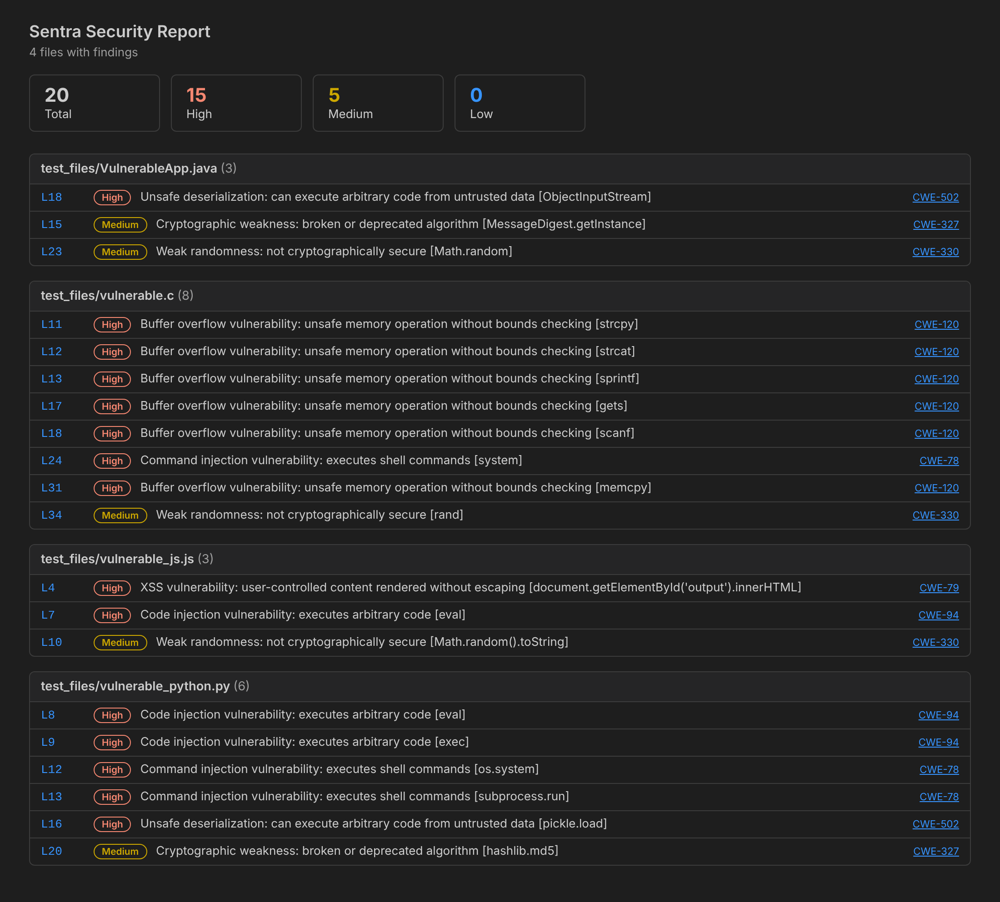

# Sentra

**Real-time, fully local security scanning for VS Code.** Sentra parses your code with
tree-sitter, follows data through each function, and flags injection, weak crypto, unsafe
deserialization, hardcoded secrets and more as you type, with quick fixes and CWE references.
10 languages, no account, no network calls.

[Install from the VS Code Marketplace](https://marketplace.visualstudio.com/items?itemName=aaryapatel.sentra) ·
[Open VSX](https://open-vsx.org/extension/aaryapatel/sentra) ·
[Accuracy](EVAL.md) · [Performance](BENCHMARKS.md)


<sub>The workspace report, rendered from real analyzer output on [`test_files/`](test_files).</sub>

## Highlights

- **Fast:** ~1.3 ms median round trip per file from the editor to the long-lived analyzer, and about
  190k lines/sec on a 4-core VM for whole-workspace scans
  (django: 500k lines in 2.6 s). [Details](BENCHMARKS.md).
- **Measured on real code:** on a held-out split of OWASP Benchmark v1.2 (981 labeled Java cases),
  precision **0.718**, recall **0.776**, OWASP score **+0.458** (v0.2: 0.486 / 0.172 / −0.018).
  Per-class results and limitations are in [EVAL.md](EVAL.md).
- **Quick fixes:** md5/sha1 → sha256, `shell=True` → argument list, `yaml.load` → `yaml.safe_load`,
  `Math.random()` → `crypto.getRandomValues`, `strcpy`/`gets` → bounded variants, and a
  one-click suppression for anything else.
- **Hovers** explain each finding, with its CWE, severity, model confidence and remediation.
- **SARIF export** for GitHub code scanning, from the editor or the CLI.
- **Private:** analysis runs on your machine. Your code never leaves it (see [Privacy](#privacy)).

## What it detects

| Rule | CWE | Examples |
|---|---|---|
| `command_injection` | [CWE-78](https://cwe.mitre.org/data/definitions/78.html) | `os.system`, `subprocess(..., shell=True)`, `Runtime.exec`, `child_process.exec`, `system()` |
| `sql_injection` | [CWE-89](https://cwe.mitre.org/data/definitions/89.html) | queries built with `+`, f-strings, `%` or `.format` reaching `execute`/`executeQuery`/`query` |
| `xss` | [CWE-79](https://cwe.mitre.org/data/definitions/79.html) | `innerHTML`, `document.write`, servlet `getWriter().print`, `mark_safe` |
| `code_injection` | [CWE-94](https://cwe.mitre.org/data/definitions/94.html) | `eval`, `exec`, `new Function`, `setTimeout("code")` |
| `path_traversal` | [CWE-22](https://cwe.mitre.org/data/definitions/22.html) | `open`, `new File`, `fs.readFile`, `fopen` with user input |
| `unsafe_deserialization` | [CWE-502](https://cwe.mitre.org/data/definitions/502.html) | `pickle.loads`, `yaml.load`, `ObjectInputStream`, `unserialize` |
| `weak_crypto` | [CWE-327](https://cwe.mitre.org/data/definitions/327.html) | MD5, SHA-1, DES, RC4, ECB via `hashlib`, `MessageDigest`, `Cipher`, `createHash` |
| `weak_randomness` | [CWE-330](https://cwe.mitre.org/data/definitions/330.html) | `Math.random`, `java.util.Random`, `rand()` |
| `hardcoded_secret` | [CWE-798](https://cwe.mitre.org/data/definitions/798.html) | string literals in `password`/`api_key`/`token` variables; AWS, GitHub, Slack, OpenAI, Google keys; private keys |
| `buffer_overflow` | [CWE-120](https://cwe.mitre.org/data/definitions/120.html) | `strcpy`, `strcat`, `sprintf`, `gets`, `scanf`, `memcpy` |
| `memory_leak` | [CWE-401](https://cwe.mitre.org/data/definitions/401.html) | `malloc`/`calloc` in a function that never calls `free` |

**Languages:** Python, JavaScript, TypeScript, Java, C, C++, Go, PHP, C#, Rust (`.py .js .jsx .mjs
.cjs .ts .tsx .java .c .h .cpp .cc .cxx .hpp .go .php .cs .rs`). Coverage differs by language: see
the sink table in [`sinks.go`](analyzer-go/internal/engine/sinks.go).

## How it works

```
 VS Code extension (TypeScript)                     sentra-analyzer --serve (Go, one process)
┌──────────────────────────────────┐   NDJSON over   ┌──────────────────────────────────────────┐
│ open / save / type (300 ms)      │   stdin/stdout  │ worker pool (runtime.NumCPU)             │
│   → settings, excludes, size     │ ──────────────► │   tree-sitter parse (pooled parsers)     │
│   → content-hash cache ──hit──┐  │  {id, analyze,  │   → AST walk: calls, assignments         │
│                               │  │   language,     │   → intra-procedural taint per function  │
│ diagnostics ◄─────────────────┘  │   content}      │   → sink table + deterministic gates     │
│ quick fixes · hovers · report    │ ◄────────────── │   → 20 features → Random Forest (30 trees│
│ SARIF export · status bar        │  {id, findings} │     embedded) → per-rule threshold       │
└──────────────────────────────────┘                 │   → suppressions → findings + CWE        │
                                                     └──────────────────────────────────────────┘
```

1. **Parse:** tree-sitter builds a syntax tree. A single cursor-based pass collects calls,
   assignments and keyword arguments, and tracks the enclosing function, branch, loop and
   try/catch context.
2. **Dataflow:** within each function, variables remember whether their value comes from user
   input (`request.*`, `input()`, `argv`, ...), a parameter, string concatenation/formatting, a
   weak algorithm name, or only constants. Branch assignments merge instead of overwriting, and
   `list.add(x)` / `sb.append(x)` taint the receiver.
3. **Sinks and gates:** a language-scoped sink table maps calls to rules. Deterministic gates
   remove cases that are safe by construction: `os.system("clear")`, `MessageDigest.getInstance("SHA-256")`,
   parameterized SQL, `setTimeout(fn)`, `regex.exec()`, `yaml.load(..., SafeLoader)`, a `malloc`
   that is freed.
4. **Model:** 20 features (sink, dataflow facts, syntactic context) go to a 30-tree Random Forest
   trained in Python (scikit-learn) and exported to JSON, which is embedded in the Go binary and
   evaluated natively (543 ns per candidate). For Java, where real labeled data exists, a finding
   is reported only above a per-rule probability threshold tuned for precision. Elsewhere the
   model supplies the confidence shown in hovers.
5. **Report:** suppressions are applied and findings are returned with positions, rule, CWE,
   severity and confidence.

## Usage

Sentra scans supported files when you open them, save them, or pause typing. Commands
(<kbd>Ctrl/Cmd+Shift+P</kbd>):

| Command | |
|---|---|
| `Sentra: Scan File for Vulnerabilities` | Scan the active file (also in the editor and explorer context menus) |
| `Sentra: Scan Workspace for Vulnerabilities` | Scan every supported file and open the report |
| `Sentra: Show Security Report` | Reopen the last workspace report |
| `Sentra: Export Results as SARIF` | Scan the workspace and write a SARIF 2.1.0 file |
| `Sentra: Clear Security Diagnostics` | Remove all Sentra diagnostics |
| `Sentra: Show Log` | Analyzer log (also opened by clicking the status bar on error) |

### Suppressing a finding

```python
digest = hashlib.md5(data)  # sentra-ignore: weak_crypto      (this line, one rule)
# sentra-ignore                                                (the next line, every rule)
# sentra-ignore-file                                           (anywhere: the whole file)
```

Any comment syntax works (`//`, `#`, `/* */`). Multiple rules: `sentra-ignore: xss, sql_injection`.

### Settings

| Setting | Default | |
|---|---|---|
| `sentra.enabled` | `true` | Turn Sentra on or off. Turning it off clears diagnostics. |
| `sentra.autoScan` | `true` | Scan on open and save. |
| `sentra.scanOnType` | `true` | Rescan while typing (requires `autoScan`). |
| `sentra.scanOnTypeDelay` | `300` | Milliseconds after the last keystroke before rescanning. |
| `sentra.severityLevel` | `Medium` | Minimum severity shown (`High`, `Medium`, `Low`). Applies without rescanning. |
| `sentra.excludePatterns` | `node_modules`, `test(s)`, `dist`, `build`, `vendor`, ... | Globs excluded from every scan. |
| `sentra.maxFileSize` | `1048576` | Skip files larger than this many bytes. |
| `sentra.enableIncrementalScanning` | `true` | Cache results by content hash; skip unchanged files. |
| `sentra.showStatusBar` | `true` | Show the status bar item. |

### CI and GitHub code scanning

The analyzer binary works on its own:

```bash
find src -name '*.py' | sentra-analyzer --batch --format sarif > sentra.sarif
```

Upload it with `github/codeql-action/upload-sarif`. Results then appear under
**Security → Code scanning**, with `security-severity` set from Sentra's severity.

## Privacy

Sentra runs entirely on your machine. The extension talks to a bundled native binary over stdin
and stdout. The binary opens no network connections and the extension sends no telemetry. Source
code is never written to temporary files. Cached results (content hashes and findings, never
source) are stored in VS Code's per-workspace storage.

## Accuracy, honestly

Numbers come from a held-out split of OWASP Benchmark v1.2 that was never used for training or
tuning:

| | precision | recall | F1 | FPR | OWASP score |
|---|--:|--:|--:|--:|--:|
| v0.2 | 0.486 | 0.172 | 0.254 | 0.190 | −0.018 |
| **v0.3** | **0.718** | **0.776** | **0.746** | **0.319** | **+0.458** |

Weak crypto and weak randomness are near perfect on this benchmark. Injection classes reach
0.44–0.64 precision, because most of the benchmark's safe cases need inter-procedural analysis
to tell apart. Command injection is the weakest class. Rules other than the six OWASP-covered ones
have no real-world measurement yet. [EVAL.md](EVAL.md) has per-class tables, the
precision/recall tradeoff, and the methodology.

## Development

```bash
npm ci
make go-build              # analyzer -> bin/local/ (needs Go 1.24+ and a C compiler)
npm run build              # bundle the extension -> dist/
npm test                   # TS unit tests (uses the real analyzer)
make go-test               # Go tests
npm run test:integration   # VS Code integration tests (downloads VS Code)
make lint                  # gofmt, go vet, ESLint, Prettier
```

Press <kbd>F5</kbd> in VS Code to launch an Extension Development Host. Reproduce the published
numbers with `scripts/benchmark.sh` and `scripts/eval.sh`. Cross-platform builds and releases are
described in [PUBLISHING.md](PUBLISHING.md).

| Path | |
|---|---|
| `src/` | VS Code extension (daemon client, scanner, cache, quick fixes, hovers, SARIF, report) |
| `analyzer-go/internal/engine/` | parser, taint, sinks, features, classifier, suppressions |
| `analyzer-go/internal/server/` | NDJSON daemon |
| `analyzer-go/cmd/sentra-bench`, `cmd/sentra-eval` | benchmark and OWASP evaluation harnesses |
| `analyzer-go/training/` | synthetic data generator and model training (scikit-learn) |

## License

[MIT](LICENSE)
